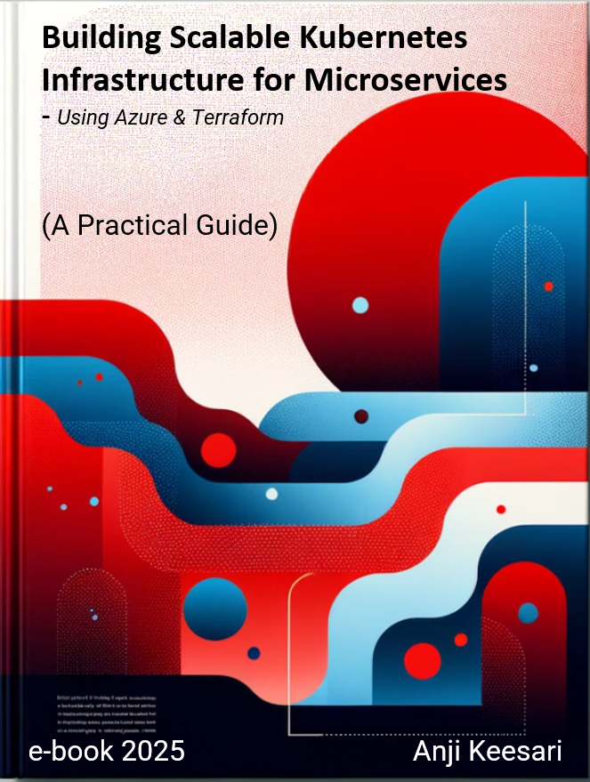

<p align="center">
  
</p>

# Building Scalable Kubernetes Infrastructure for Microservices

**A practical, hands-on guide to building production-style Kubernetes infrastructure on Azure with Terraform.**

[](https://github.com/akeesari/kubernetes/actions/workflows/ci.yml)
[](https://kubernetes.anjikeesari.com)
[](LICENSE)

**Read the book free online: <https://kubernetes.anjikeesari.com>**

> Status: work in progress. You are welcome to read what has been written so far; more chapters are on the way.

## What you will learn

Each chapter is a self-contained lab that you can follow step by step:

- **Foundations**: Infrastructure as Code, microservices on Kubernetes, Terraform setup and remote state.
- **Azure infrastructure with Terraform**: Log Analytics, Virtual Network (hub and spoke), Container Registry, Application Gateway, AKS, PostgreSQL Flexible Server, Key Vault, Redis, Storage, Event Hubs, Front Door / CDN.
- **Kubernetes on AKS**: containerizing .NET apps, deploying APIs and web apps, NGINX and AGIC ingress, cert-manager with Let's Encrypt, Key Vault integration, node pools and upgrades, pod troubleshooting, monitoring with Azure Monitor and Managed Grafana.

Every lab follows the same format: Introduction, Technical Scenario, Prerequisites, Objective, Architecture Diagram, Implementation, Validation and References. See [Lab Format](docs/gettingstarted/lab-format.md).

## Who this is for

Cloud, DevOps and platform engineers, and developers who want a realistic path from "it runs on my machine" to a secure, scalable AKS environment defined as code.

## Prerequisites

| Tool | Used for |
|---|---|
| Azure subscription | Target environment (labs create billable resources) |
| Terraform | Infrastructure as Code |
| Azure CLI | Authentication and resource management |
| kubectl and Helm | Working with the cluster |
| Docker | Building container images |
| Visual Studio Code | Editing |

## Run the site locally

Requires Python 3.9 or later.

```sh
git clone https://github.com/akeesari/kubernetes.git
cd kubernetes
python -m venv .venv
# Windows: .venv\Scripts\activate    macOS/Linux: source .venv/bin/activate
pip install -r requirements.txt
mkdocs serve
```

Open <http://127.0.0.1:8000>.

## Repository layout

```
docs/            Book content (Markdown) and images, one folder per section
docs/overrides/  Theme overrides (home page, 404, footer)
mkdocs.yml       Site configuration and navigation
.github/         CI: builds on pull requests, deploys on push to main
```

## About the author

**Anji Keesari** is a software engineer and cloud architect with 20+ years of experience across banking, healthcare and finance, specializing in Kubernetes, Terraform, Azure and microservices.

I also offer tutoring and training on these topics.

- Website: <https://anjikeesari.com>
- Email: <anjkeesari@gmail.com>
- GitHub: <https://github.com/akeesari>

## Feedback

Found a typo, a broken command or an outdated step? Please open an [issue](https://github.com/akeesari/kubernetes/issues). See [CONTRIBUTING.md](CONTRIBUTING.md).

## License

Copyright (c) 2025 Anji Keesari. **All rights reserved.** The content may be read for personal learning but may not be copied, redistributed or reused without written permission. See [LICENSE](LICENSE).
